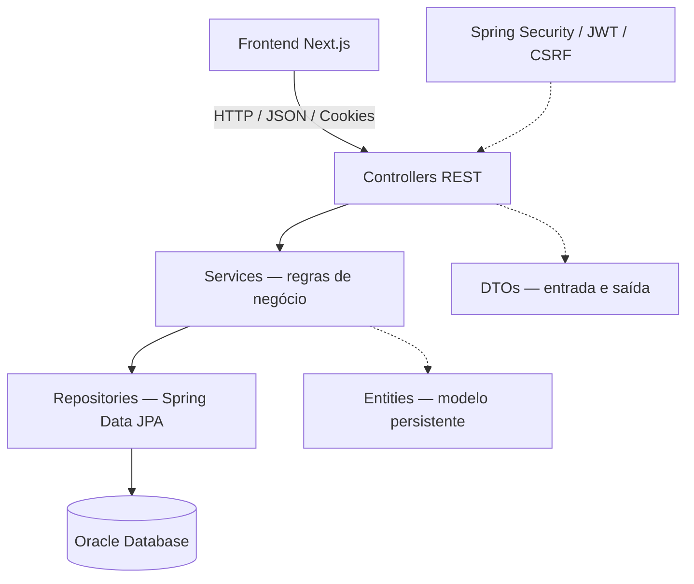
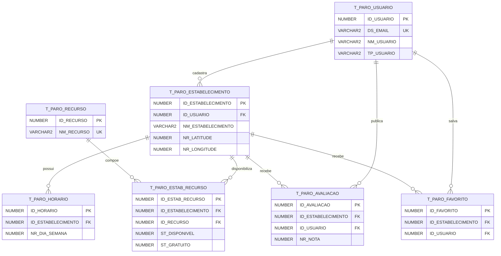

# Parô — API REST (Backend Java)

> **Global Solution 2026 — FIAP | CitizenTech**  
> Backend da plataforma Parô, destinada a conectar motoristas e entregadores a estabelecimentos que oferecem pontos de apoio durante a jornada de trabalho.

## Sumário

1. [Sobre o projeto](#sobre-o-projeto)
2. [Funcionalidades](#funcionalidades)
3. [Tecnologias](#tecnologias)
4. [Arquitetura](#arquitetura)
5. [Pré-requisitos](#pré-requisitos)
6. [Configuração do ambiente](#configuração-do-ambiente)
7. [Execução e testes](#execução-e-testes)
8. [Autenticação e segurança](#autenticação-e-segurança)
9. [Documentação dos endpoints](#documentação-dos-endpoints)
10. [Exemplos de requisições](#exemplos-de-requisições)
11. [Banco de dados Oracle](#banco-de-dados-oracle)
12. [Regras de negócio](#regras-de-negócio)
13. [Limitações e observações](#limitações-e-observações)
14. [Repositório](#repositório)

## Sobre o projeto

O **Parô** é um MVP desenvolvido para a **Global Solution 2026 da FIAP**, no contexto do desafio **CitizenTech**. Seu objetivo é facilitar a localização de estabelecimentos que disponibilizam recursos úteis para pessoas que trabalham nas ruas, como **água potável, banheiro e locais para descanso**.

O backend concentra as regras de negócio, a persistência no Oracle Database e a disponibilização de uma API REST utilizada pela interface desenvolvida em Next.js.

**Públicos atendidos:**

- **Trabalhador (`TRABALHADOR`)**: consulta pontos de apoio, salva favoritos e publica avaliações.
- **Estabelecimento (`ESTABELECIMENTO`)**: cadastra e administra pontos de apoio, recursos e horários de funcionamento.

## Funcionalidades

- Cadastro de usuários, autenticação e consulta da sessão.
- Cadastro, consulta, edição, ativação e desativação de estabelecimentos.
- Pesquisa de estabelecimentos por texto e busca por proximidade geográfica.
- Associação de recursos aos estabelecimentos, com disponibilidade, gratuidade e condições de uso.
- Gerenciamento dos horários de funcionamento.
- Cadastro, consulta, atualização e exclusão de avaliações.
- Lista pessoal de estabelecimentos favoritos.
- Indicadores de impacto sobre estabelecimentos, bairros e recursos cadastrados.
- Verificação de saúde da API.

## Tecnologias

| Tecnologia | Utilização |
|---|---|
| **Java 21** | Linguagem da aplicação |
| **Spring Boot 4.1.2** | Base da API |
| Spring Web MVC | Controllers e rotas REST |
| Spring Data JPA / Hibernate | Mapeamento objeto-relacional e persistência |
| Spring Security | Autenticação e autorização |
| OAuth2 Resource Server | Validação de tokens JWT |
| Spring Validation | Validação dos dados de entrada |
| **Oracle Database** | Banco de dados relacional |
| Oracle JDBC (`ojdbc17`) | Driver de conexão |
| Maven Wrapper | Build e gerenciamento das dependências |

A versão do Java utilizada no projeto é **21**. Recomenda-se manter o `pom.xml` consistente, sem propriedades `maven.compiler.source` ou `target` apontando para outra versão.

## Arquitetura

O projeto segue uma **arquitetura em camadas, organizada por domínio funcional**. Em cada domínio, os componentes são separados conforme suas responsabilidades.



### Organização dos pacotes

```text
src/main/java/br/group/paro/
├── ParoApplication.java
├── auth/                  # Login, sessão, JWT e Rate Limiting
├── busca/                 # Consulta por proximidade
├── common/exception/     # Exceções e tratamento global
├── config/                # Spring Security, JWT, CORS e senhas
├── estabelecimento/      # Estabelecimentos, horários e avaliações
├── estabelecimentorecurso/# Associação entre estabelecimentos e recursos
├── favorito/              # Favoritos dos usuários
├── health/                # Verificação de saúde
├── impacto/               # Indicadores agregados
├── recurso/               # Catálogo de recursos
└── usuario/               # Cadastro e perfil de usuários
```

**Responsabilidades das camadas:**

- **Controller:** recebe requisições HTTP, aplica validações de entrada e devolve respostas.
- **Service:** centraliza regras de negócio, operações e verificações de propriedade.
- **Repository:** realiza consultas e operações de persistência no Oracle via JPA.
- **Entity:** representa as tabelas e relacionamentos persistidos.
- **DTO:** define os contratos de entrada e saída, sem expor diretamente as entidades.
- **Config:** concentra a infraestrutura de autenticação, cookies, CORS e criptografia de senhas.

## Pré-requisitos

- **JDK 21** instalado e configurado (`java -version`).
- **Oracle Database** acessível e com o esquema do Parô criado previamente.
- Conexão de rede com o serviço Oracle configurado.
- Git para clonar o projeto.
- Frontend Next.js, caso deseje executar a aplicação completa.

O repositório inclui **Maven Wrapper** (`mvnw` e `mvnw.cmd`), portanto não é necessário instalar o Maven globalmente.

## Configuração do ambiente

As configurações principais estão em `src/main/resources/application.properties` e usam variáveis de ambiente.

| Variável | Obrigatória | Descrição | Exemplo local |
|---|---|---|---|
| `DB_URL` | Sim | URL JDBC do Oracle | `jdbc:oracle:thin:@//HOST:1521/SERVICE_NAME` |
| `DB_USERNAME` | Sim | Usuário do Oracle | `SEU_USUARIO` |
| `DB_PASSWORD` | Sim | Senha do Oracle | `SUA_SENHA` |
| `JWT_SECRET` | Sim | Segredo **Base64** usado para assinar/verificar JWT | Gerar com segurança |
| `FRONTEND_URL` | Não | Origem permitida para o frontend | `http://localhost:3000` |
| `COOKIE_SECURE` | Não | Define atributo `Secure` do cookie de autenticação | `false` em localhost / `true` com HTTPS |

### Exemplo de configuração no PowerShell

Execute na raiz do repositório, substituindo os valores de exemplo pelos do seu ambiente:

```powershell
$env:DB_URL = "jdbc:oracle:thin:@//HOST:1521/SERVICE_NAME"
$env:DB_USERNAME = "SEU_USUARIO"
$env:DB_PASSWORD = "SUA_SENHA"
$env:JWT_SECRET = "SUA_CHAVE_BASE64_GERADA_COM_SEGURANCA"
$env:FRONTEND_URL = "http://localhost:3000"
$env:COOKIE_SECURE = "false"
```

Para gerar uma chave aleatória Base64 de 32 bytes **no seu ambiente local**, utilize:

```powershell
$bytes = New-Object byte[] 32
$rng = [System.Security.Cryptography.RandomNumberGenerator]::Create()
try { $rng.GetBytes($bytes) } finally { $rng.Dispose() }
[Convert]::ToBase64String($bytes)
```

Use a saída como valor de `JWT_SECRET`. **Não publique segredos, senhas ou arquivos de configuração privados no Git.**

> **Nota:** o Spring Boot não importa automaticamente qualquer arquivo `.env` colocado na raiz do projeto. Configure as variáveis no terminal, na IDE ou por outro mecanismo de configuração explicitamente habilitado.

### Propriedades relevantes

```properties
spring.application.name=paro
server.port=8080

spring.datasource.url=${DB_URL}
spring.datasource.username=${DB_USERNAME}
spring.datasource.password=${DB_PASSWORD}
spring.datasource.driver-class-name=oracle.jdbc.OracleDriver

spring.jpa.hibernate.ddl-auto=validate
spring.jpa.show-sql=true
spring.jpa.properties.hibernate.format_sql=true

app.frontend.url=${FRONTEND_URL:http://localhost:3000}
app.jwt.secret=${JWT_SECRET}
app.jwt.issuer=paro-api
app.jwt.expiration-minutes=120
app.auth.cookie-secure=${COOKIE_SECURE:false}
```

A propriedade `ddl-auto=validate` **não cria nem atualiza as tabelas**: o banco precisa estar preparado previamente. `show-sql=true` é útil para desenvolvimento; considere desabilitá-lo em produção.

## Execução e testes

### 1. Clonar o repositório

```powershell
git clone https://github.com/Lsko27/Paro-Java-Backend.git
cd Paro-Java-Backend
```

### 2. Configurar as variáveis de ambiente

Defina `DB_URL`, `DB_USERNAME`, `DB_PASSWORD` e `JWT_SECRET` antes de executar a aplicação. Consulte [Configuração do ambiente](#configuração-do-ambiente).

### 3. Iniciar o backend

**Windows / PowerShell:**

```powershell
.\mvnw.cmd spring-boot:run
```

**Linux / macOS:**

```bash
./mvnw spring-boot:run
```

A API ficará disponível em **`http://localhost:8080/api/v1`**, desde que o banco esteja acessível e a inicialização seja concluída sem erros.

### 4. Verificar a saúde da aplicação

```powershell
Invoke-RestMethod "http://localhost:8080/api/v1/health"
```

### 5. Compilar e executar os testes disponíveis

```powershell
.\mvnw.cmd clean verify
```

O comando executa o ciclo Maven de verificação, incluindo testes automatizados que estejam presentes e configurados no projeto. Ele não substitui testes funcionais manuais de autenticação e integração com Oracle.

### 6. Gerar o pacote

```powershell
.\mvnw.cmd clean package
```

O artefato produzido ficará na pasta `target/`, conforme a configuração do Maven.

## Autenticação e segurança

O Parô utiliza autenticação baseada em **JWT**, com sessão **stateless** e transporte do token em cookie **`paro_token`** com `HttpOnly`. O token é emitido pela API e validado pelo Spring Security, por meio do OAuth2 Resource Server e do `CookieBearerTokenResolver`.

### Medidas implementadas

| Controle | Implementação |
|---|---|
| JWT | Emissor `paro-api`, expiração configurada em **120 minutos** |
| Cookie de autenticação | `paro_token`, `HttpOnly`, `SameSite=Lax`; `Secure` configurável |
| Senhas | Hash verificado com `PasswordEncoder` do Spring Security |
| Sessão | `SessionCreationPolicy.STATELESS` |
| CSRF | `CookieCsrfTokenRepository` e filtro CSRF manual |
| Cabeçalho CSRF | `X-XSRF-TOKEN` em operações de escrita protegidas |
| CORS | Origem do frontend configurável via `FRONTEND_URL` |
| Rate Limiting por IP + e-mail | **5 falhas** em uma janela de **5 minutos** |
| Rate Limiting adicional por IP | **30 falhas** em uma janela de **5 minutos** |
| Autorização | Rotas públicas liberadas explicitamente; demais exigem autenticação |
| Propriedade dos dados | Regras de negócio impedem alterações indevidas de recursos de outros usuários |

**CSRF:** requisições com métodos considerados seguros (`GET`, `HEAD`, `OPTIONS`, `TRACE`) não exigem token CSRF. As rotas `POST /auth/register` e `POST /auth/login` também foram dispensadas da verificação CSRF na implementação atual. As demais operações de escrita protegidas exigem o token apropriado.

**Rate Limiting:** ao exceder os limites, a API responde **HTTP `429 Too Many Requests`**. A implementação atual mantém os contadores **em memória**; eles são reiniciados junto com o processo Java e não são compartilhados entre múltiplas instâncias.

**Logout:** remove o cookie no cliente. Como os JWTs são stateless, um token já emitido não é automaticamente revogado no servidor antes de expirar.

**Produção:** habilite HTTPS e `COOKIE_SECURE=true`, proteja os segredos e configure corretamente a identificação do IP original quando houver proxies reversos. A configuração atual foi validada principalmente para um MVP acadêmico/local.

### API pública × páginas privadas

Algumas consultas da API (por exemplo, busca, recursos e impacto) são públicas segundo o `SecurityConfig`. O frontend pode exigir login para acessar páginas como `/explore` ou `/impact`; isso **não altera** o caráter público desses endpoints no backend.

## Documentação dos endpoints

**Base URL:** `http://localhost:8080/api/v1`  
Todos os caminhos abaixo são relativos à base URL. Os **34 endpoints** foram levantados a partir dos mapeamentos dos controllers.

**Legenda:** `Público` = não exige sessão JWT; `Autenticado` = exige sessão JWT. Operações protegidas por autenticação também podem exigir CSRF e autorização adicional de negócio.

### Autenticação e usuários

| Método | Endpoint | Acesso | Finalidade |
|---|---|---|---|
| `POST` | `/auth/register` | Público | Cadastrar usuário |
| `POST` | `/auth/login` | Público | Autenticar e emitir cookie JWT |
| `GET` | `/auth/me` | Autenticado | Consultar usuário autenticado |
| `GET` | `/auth/csrf` | Público | Obter token CSRF |
| `POST` | `/auth/logout` | Autenticado | Encerrar sessão no cliente |
| `PUT` | `/usuarios/me` | Autenticado | Atualizar perfil do usuário |

### Estabelecimentos e busca

| Método | Endpoint | Acesso | Finalidade |
|---|---|---|---|
| `POST` | `/estabelecimentos` | Autenticado | Cadastrar estabelecimento |
| `GET` | `/estabelecimentos` | Público | Listar estabelecimentos |
| `GET` | `/estabelecimentos/pesquisar` | Público | Pesquisar por texto (ex.: `?termo=cafe`) |
| `GET` | `/estabelecimentos/buscar` | Público | Buscar por proximidade |
| `GET` | `/estabelecimentos/meus` | Autenticado | Consultar estabelecimentos do usuário |
| `GET` | `/estabelecimentos/{id}` | Público | Consultar detalhes |
| `PUT` | `/estabelecimentos/{id}` | Autenticado | Atualizar estabelecimento |
| `PATCH` | `/estabelecimentos/{id}/condicoes-acesso` | Autenticado | Atualizar condições de acesso |
| `PATCH` | `/estabelecimentos/{id}/ativar` | Autenticado | Ativar estabelecimento |
| `PATCH` | `/estabelecimentos/{id}/desativar` | Autenticado | Desativar estabelecimento |

### Horários de funcionamento

| Método | Endpoint | Acesso | Finalidade |
|---|---|---|---|
| `GET` | `/estabelecimentos/{estabelecimentoId}/horarios` | Público | Consultar horários |
| `PUT` | `/estabelecimentos/{estabelecimentoId}/horarios` | Autenticado | Atualizar horários |

### Recursos

| Método | Endpoint | Acesso | Finalidade |
|---|---|---|---|
| `GET` | `/recursos` | Público | Consultar catálogo de recursos |
| `POST` | `/estabelecimentos/{estabelecimentoId}/recursos` | Autenticado | Associar um recurso |
| `GET` | `/estabelecimentos/{estabelecimentoId}/recursos` | Público | Consultar recursos de um estabelecimento |
| `GET` | `/estabelecimentos/{estabelecimentoId}/recursos/gerenciar` | Autenticado | Consultar recursos para gerenciamento |
| `PUT` | `/estabelecimentos/recursos/{associacaoId}` | Autenticado | Atualizar associação de recurso |
| `DELETE` | `/estabelecimentos/recursos/{associacaoId}` | Autenticado | Remover associação de recurso |

### Avaliações

| Método | Endpoint | Acesso | Finalidade |
|---|---|---|---|
| `GET` | `/estabelecimentos/{estabelecimentoId}/avaliacoes` | Público | Listar avaliações |
| `GET` | `/estabelecimentos/{estabelecimentoId}/avaliacoes/resumo` | Público | Consultar média e quantidade |
| `POST` | `/estabelecimentos/{estabelecimentoId}/avaliacoes` | Autenticado | Criar avaliação |
| `PUT` | `/estabelecimentos/{estabelecimentoId}/avaliacoes/minha` | Autenticado | Atualizar avaliação própria |
| `DELETE` | `/estabelecimentos/{estabelecimentoId}/avaliacoes/minha` | Autenticado | Excluir avaliação própria |

### Favoritos

| Método | Endpoint | Acesso | Finalidade |
|---|---|---|---|
| `GET` | `/favoritos` | Autenticado | Listar favoritos próprios |
| `POST` | `/favoritos/{estabelecimentoId}` | Autenticado | Adicionar favorito |
| `DELETE` | `/favoritos/{estabelecimentoId}` | Autenticado | Remover favorito |

### Impacto e monitoramento

| Método | Endpoint | Acesso | Finalidade |
|---|---|---|---|
| `GET` | `/impacto/resumo` | Público | Obter indicadores agregados |
| `GET` | `/health` | Público | Verificar disponibilidade da API |

> As rotas acima descrevem os mapeamentos conhecidos. Campos de query, formatos completos de todos os DTOs, status de sucesso e validações específicas devem ser consultados nos respectivos controllers e DTOs ao realizar integrações adicionais.

## Exemplos de requisições

Os exemplos usam **PowerShell** e dados fictícios. Ajuste-os à sua instalação local.

### Cadastro de usuário

```powershell
$registerBody = @{
  nome = "Usuario Teste"
  email = "usuario-teste@example.com"
  telefone = "11999999999"
  senha = "SenhaTeste123!"
  tipoUsuario = "TRABALHADOR"
} | ConvertTo-Json

Invoke-RestMethod `
  -Uri "http://localhost:8080/api/v1/auth/register" `
  -Method POST `
  -ContentType "application/json" `
  -Body $registerBody
```

Os valores possíveis de `tipoUsuario` são `TRABALHADOR` e `ESTABELECIMENTO`. O telefone, se informado, deve conter 10 ou 11 dígitos com DDD, sem pontuação. A senha possui validação de tamanho no DTO.

### Login e consulta da sessão

```powershell
$session = New-Object Microsoft.PowerShell.Commands.WebRequestSession

$loginBody = @{
  email = "usuario-teste@example.com"
  senha = "SenhaTeste123!"
} | ConvertTo-Json

Invoke-RestMethod `
  -Uri "http://localhost:8080/api/v1/auth/login" `
  -Method POST `
  -ContentType "application/json" `
  -Body $loginBody `
  -WebSession $session

Invoke-RestMethod `
  -Uri "http://localhost:8080/api/v1/auth/me" `
  -WebSession $session
```

O `WebRequestSession` preserva o cookie retornado pelo login para a segunda requisição. Não inclua credenciais reais em exemplos versionados.

### Obter token CSRF

```powershell
$csrf = Invoke-RestMethod `
  -Uri "http://localhost:8080/api/v1/auth/csrf" `
  -WebSession $session

$csrf.headerName
$csrf.token
```

Para operações de escrita protegidas (como alterar um estabelecimento), envie o token no cabeçalho `X-XSRF-TOKEN`, preservando também o cookie de sessão e os cookies CSRF por meio da mesma sessão HTTP.

### Consultas públicas

```powershell
Invoke-RestMethod "http://localhost:8080/api/v1/recursos"
Invoke-RestMethod "http://localhost:8080/api/v1/impacto/resumo"
Invoke-RestMethod "http://localhost:8080/api/v1/estabelecimentos/pesquisar?termo=cafe"
```

### Cadastro de estabelecimento — formato de entrada

O DTO `EstabelecimentoRequest` recebe os seguintes campos (exemplo ilustrativo com coordenadas de teste):

```json
{
  "nome": "Ponto de Apoio Exemplo",
  "descricao": "Estabelecimento fictício para testes.",
  "condicoesAcesso": "Água e banheiro disponíveis aos trabalhadores.",
  "cep": "01310100",
  "logradouro": "Avenida Paulista",
  "numero": "1000",
  "bairro": "Bela Vista",
  "cidade": "São Paulo",
  "uf": "SP",
  "latitude": -23.5643,
  "longitude": -46.6525,
  "imagemUrl": null
}
```

A rota de criação requer autenticação, token CSRF válido e as autorizações previstas no serviço. Os dados são **fictícios** e não identificam um estabelecimento real.

## Banco de dados Oracle

O modelo persistente possui **7 tabelas**, **7 chaves primárias**, **8 chaves estrangeiras** e **6 restrições de unicidade**, conforme levantamento do esquema Oracle utilizado no projeto.

### Tabelas e finalidades

| Tabela | Descrição | Chave primária |
|---|---|---|
| `T_PARO_USUARIO` | Usuários e credenciais | `ID_USUARIO` |
| `T_PARO_ESTABELECIMENTO` | Pontos de apoio e localização | `ID_ESTABELECIMENTO` |
| `T_PARO_RECURSO` | Catálogo de recursos | `ID_RECURSO` |
| `T_PARO_ESTAB_RECURSO` | Recursos oferecidos por estabelecimento | `ID_ESTAB_RECURSO` |
| `T_PARO_HORARIO` | Horários de funcionamento | `ID_HORARIO` |
| `T_PARO_AVALIACAO` | Notas e comentários | `ID_AVALIACAO` |
| `T_PARO_FAVORITO` | Relação de favoritos | `ID_FAVORITO` |

### Diagrama entidade-relacionamento (DER simplificado)



### Restrições de unicidade

| Tabela | Coluna(s) únicas | Regra |
|---|---|---|
| `T_PARO_USUARIO` | `DS_EMAIL` | Não permite e-mails duplicados |
| `T_PARO_RECURSO` | `NM_RECURSO` | Não permite nomes de recursos duplicados |
| `T_PARO_AVALIACAO` | `ID_ESTABELECIMENTO`, `ID_USUARIO` | Uma avaliação por usuário e estabelecimento |
| `T_PARO_FAVORITO` | `ID_USUARIO`, `ID_ESTABELECIMENTO` | Não permite repetir o mesmo favorito |
| `T_PARO_ESTAB_RECURSO` | `ID_ESTABELECIMENTO`, `ID_RECURSO` | Não permite duplicar a associação de recurso |
| `T_PARO_HORARIO` | `ID_ESTABELECIMENTO`, `NR_DIA_SEMANA` | Um registro de horário por dia e estabelecimento |

As restrições com duas colunas são **compostas**: o conjunto é único, não cada coluna isoladamente.

### Dicionário de dados resumido

**Tipos Oracle identificados:** `NUMBER`, `VARCHAR2` e `TIMESTAMP(6)`. A coluna `NULL?` indica se aceita valores nulos (`Sim`/`Não`). Os tamanhos/precisões não estão apresentados neste resumo, pois não constavam no levantamento fornecido.

<details>
<summary><strong>T_PARO_USUARIO</strong> — 7 colunas</summary>

| Coluna | Tipo | NULL? |
|---|---|---|
| ID_USUARIO | NUMBER | Não |
| NM_USUARIO | VARCHAR2 | Não |
| DS_EMAIL | VARCHAR2 | Não |
| DS_SENHA | VARCHAR2 | Não |
| TP_USUARIO | VARCHAR2 | Não |
| DT_CRIACAO | TIMESTAMP(6) | Não |
| NR_TELEFONE | VARCHAR2 | Sim |

</details>

<details>
<summary><strong>T_PARO_ESTABELECIMENTO</strong> — 16 colunas</summary>

| Coluna | Tipo | NULL? |
|---|---|---|
| ID_ESTABELECIMENTO | NUMBER | Não |
| NM_ESTABELECIMENTO | VARCHAR2 | Não |
| DS_ESTABELECIMENTO | VARCHAR2 | Sim |
| NR_CEP | VARCHAR2 | Não |
| DS_LOGRADOURO | VARCHAR2 | Não |
| NR_ENDERECO | VARCHAR2 | Não |
| NM_BAIRRO | VARCHAR2 | Não |
| NM_CIDADE | VARCHAR2 | Não |
| SG_UF | VARCHAR2 | Não |
| NR_LATITUDE | NUMBER | Não |
| NR_LONGITUDE | NUMBER | Não |
| ST_ATIVO | NUMBER | Não |
| DT_CRIACAO | TIMESTAMP(6) | Não |
| ID_USUARIO | NUMBER | Não |
| DS_URL_IMAGEM | VARCHAR2 | Sim |
| DS_CONDICOES_ACESSO | VARCHAR2 | Sim |

</details>

<details>
<summary><strong>T_PARO_RECURSO</strong> — 3 colunas</summary>

| Coluna | Tipo | NULL? |
|---|---|---|
| ID_RECURSO | NUMBER | Não |
| NM_RECURSO | VARCHAR2 | Não |
| DS_RECURSO | VARCHAR2 | Sim |

</details>

<details>
<summary><strong>T_PARO_ESTAB_RECURSO</strong> — 6 colunas</summary>

| Coluna | Tipo | NULL? |
|---|---|---|
| ID_ESTAB_RECURSO | NUMBER | Não |
| ID_ESTABELECIMENTO | NUMBER | Não |
| ID_RECURSO | NUMBER | Não |
| ST_DISPONIVEL | NUMBER | Não |
| ST_GRATUITO | NUMBER | Não |
| DS_CONDICAO | VARCHAR2 | Sim |

</details>

<details>
<summary><strong>T_PARO_HORARIO</strong> — 6 colunas</summary>

| Coluna | Tipo | NULL? |
|---|---|---|
| ID_HORARIO | NUMBER | Não |
| ID_ESTABELECIMENTO | NUMBER | Não |
| NR_DIA_SEMANA | NUMBER | Não |
| HR_ABERTURA | VARCHAR2 | Sim |
| HR_FECHAMENTO | VARCHAR2 | Sim |
| ST_FECHADO | NUMBER | Não |

</details>

<details>
<summary><strong>T_PARO_AVALIACAO</strong> — 7 colunas</summary>

| Coluna | Tipo | NULL? |
|---|---|---|
| ID_AVALIACAO | NUMBER | Não |
| ID_ESTABELECIMENTO | NUMBER | Não |
| ID_USUARIO | NUMBER | Não |
| NR_NOTA | NUMBER | Não |
| DS_COMENTARIO | VARCHAR2 | Sim |
| DT_CRIACAO | TIMESTAMP(6) | Não |
| DT_ATUALIZACAO | TIMESTAMP(6) | Sim |

</details>

<details>
<summary><strong>T_PARO_FAVORITO</strong> — 3 colunas</summary>

| Coluna | Tipo | NULL? |
|---|---|---|
| ID_FAVORITO | NUMBER | Não |
| ID_USUARIO | NUMBER | Não |
| ID_ESTABELECIMENTO | NUMBER | Não |

</details>

### Conferência do esquema Oracle

Para verificar as tabelas existentes no usuário conectado:

```sql
SELECT table_name
FROM user_tables
WHERE table_name LIKE 'T_PARO_%'
ORDER BY table_name;
```

> Este README descreve o esquema observado no banco do projeto, mas **não substitui os scripts SQL de criação/migração**. Como o JPA utiliza `ddl-auto=validate`, uma nova instalação precisa receber previamente a estrutura e as permissões corretas do Oracle.

## Regras de negócio

- Usuários são classificados como `TRABALHADOR` ou `ESTABELECIMENTO`.
- Alterações em estabelecimentos, horários e recursos exigem autenticação e verificações de autorização no backend.
- A unicidade composta em `T_PARO_AVALIACAO` impede que o mesmo usuário avalie duas vezes o mesmo estabelecimento; a API oferece atualização e exclusão da avaliação própria.
- Favoritos pertencem ao usuário autenticado e não podem ser duplicados para o mesmo estabelecimento.
- Horários são identificados pelo par estabelecimento/dia da semana.
- Recursos podem ser associados a diferentes estabelecimentos, com dados próprios de disponibilidade, gratuidade e condições.
- A consulta de impacto agrega quantidade de estabelecimentos, bairros e recursos conforme os dados cadastrados.

## Limitações e observações

- **Escopo:** MVP acadêmico; não representa homologação de segurança para uso público em larga escala.
- **Rate Limiting:** contadores em memória e limitados à instância Java; ambientes distribuídos exigem armazenamento/limitação compartilhados.
- **Proxy reverso:** é necessário configurar corretamente a origem do IP do cliente e a cadeia de proxies confiáveis antes de usar limites globais por IP em produção.
- **Logout de JWT:** remover o cookie não revoga imediatamente um token já emitido que tenha sido copiado antes do logout.
- **Esquema Oracle:** precisa existir antes da inicialização com `ddl-auto=validate`.
- **CSRF no login/cadastro:** as duas rotas estão explicitamente dispensadas no `SecurityConfig` atual, decisão que merece reavaliação para implantação pública.
- **Segredos e logs:** nunca versionar `DB_PASSWORD` ou `JWT_SECRET`; evitar logs SQL detalhados em produção.

## Repositório

- **Backend Java:** [Lsko27/Paro-Java-Backend](https://github.com/Lsko27/Paro-Java-Backend)
- **Projeto:** Parô — Global Solution 2026 / FIAP — CitizenTech.

---

**Parô:** pontos de apoio mais acessíveis para quem mantém a cidade em movimento.
